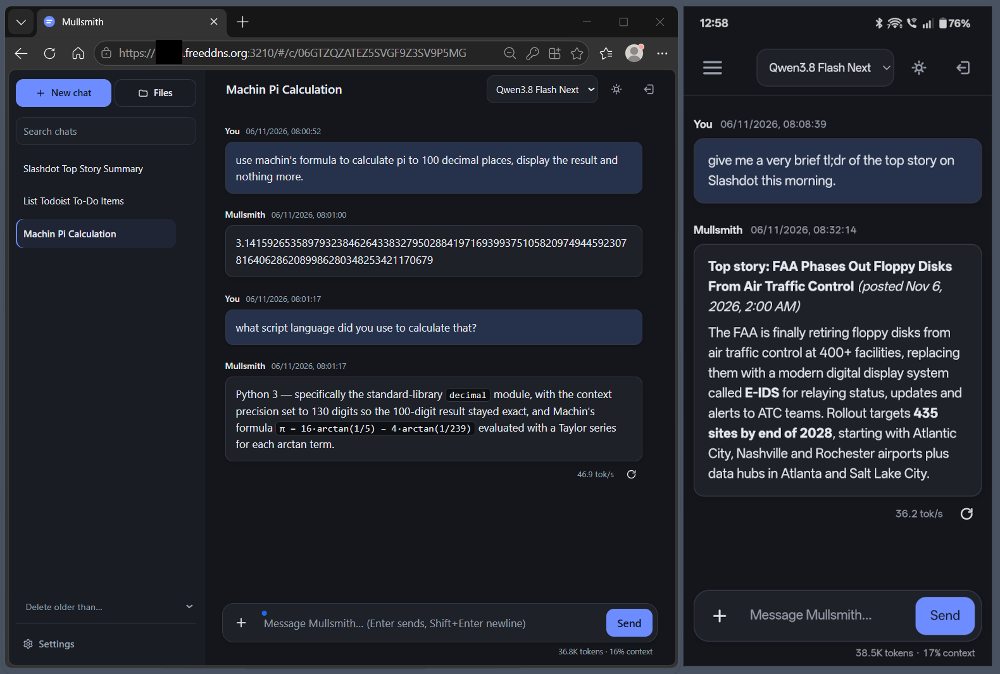

# Mullsmith

**Your AI assistant, from your browser.**

Chat with your models, work with files and get help with tasks from your computer,
tablet or phone. Run Mullsmith on a Linux computer or server, connect it to your
model server or a supported hosted provider, and open it in your browser.

Mullsmith provides the assistant and its tools; it does not download or run the
language model itself.

  

- **Easy setup with thinking controls built in.** Included catalogues cover
  popular model servers and model-specific thinking settings, giving you
  reasoning controls suited to your model. Extend the catalogues to support
  new endpoints and models.
- **Go beyond chat.** Work with files and images, search the web, and let the
  assistant run code to calculate, process data and create downloadable results.
  Optional code execution is isolated and has approval controls.
- **Connect more tools and services.** Add local or remote MCP servers to extend
  what your assistant can do. OAuth support lets each user connect their own
  account to compatible services through Settings.
- **Keep accounts and history on your server.** Access your chats from all your
  devices. Mullsmith supports multiple user accounts.
- **Responsive page design.** Access Mullsmith from your PC, tablet or mobile
  phone, or save it to your home screen as a web app.
- **Keep setup simple.** Install a small, self-contained application, with no
  separate database to manage. Built-in HTTPS supports access beyond your home
  network when configured.

## Get started

You need a Linux computer or server, administrator access to install Mullsmith,
and a running model server or supported hosted provider. Have your model's API
address, model ID and any required API key ready.

**[Follow the Quick start](QUICKSTART.md)** to install Mullsmith, create your
account, connect your model and get your first reply.

Mullsmith is intended for you and people you trust. For access over the internet,
follow the [HTTPS setup](GUIDE.md#internet-access-and-https) and keep registration
invite-only or closed.

Other installation options:
[Tar installation](GUIDE.md#tar-archive) ·
[Build from source](GUIDE.md#building-from-source)

## Learn more

- [Full guide](GUIDE.md) — setup, tools and everyday administration.
- [Models and thinking controls](GUIDE.md#models-and-thinking-controls) — connect
  your model and configure its capabilities.
- [Enable tools](GUIDE.md#enable-tools) — set up web search, code execution and
  connections to other tools.
- [MCP servers and OAuth](GUIDE.md#mcp-tool-servers) — add tools and let users
  connect their service accounts.
- [Accounts and invitations](GUIDE.md#accounts-and-invitations) — give others access.
- [Troubleshooting](GUIDE.md#troubleshooting) — help when something does not work.
- [Configuration reference](configs/config.yaml) — detailed settings when you need them.
